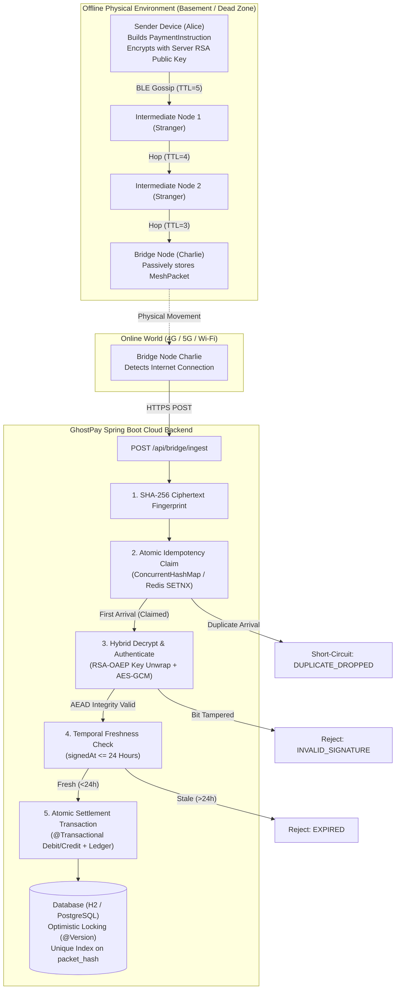
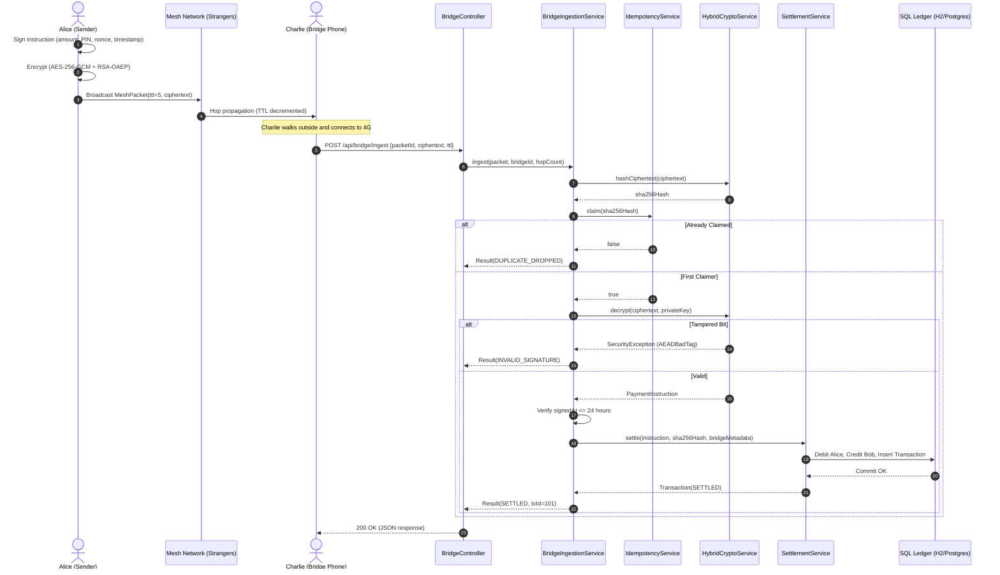

# System Architecture — GhostPay

**Architecture Specification**: Mesh-Routed Deferred Settlement Pipeline  
**Version**: 1.0.0  
**Domain**: Financial Cryptography & Distributed Systems  

---

## 1. System Topology & End-to-End Overview

GhostPay bridges offline zero-connectivity physical environments with centralized banking ledgers using an opportunistic delay-tolerant mesh network.



---

## 2. The 5-Stage Ingestion Pipeline

When a bridge device POSTs a packet to `/api/bridge/ingest`, the request executes through 5 strict gates:

```
Wire Packet (MeshPacket)
   │
   ▼
[ Gate 1: Fingerprint ] ───────▶ Compute SHA-256(ciphertext)
   │
   ▼
[ Gate 2: Claim ] ─────────────▶ Atomic putIfAbsent(hash, timestamp).
   │                             If present: Abort as DUPLICATE_DROPPED (Zero CPU wasted)
   │
   ▼
[ Gate 3: Decrypt & Auth ] ────▶ RSA-OAEP unwraps AES key.
   │                             AES-GCM decrypts payload & verifies 128-bit tag.
   │                             If tag invalid: Abort as INVALID_SIGNATURE
   │
   ▼
[ Gate 4: Freshness ] ─────────▶ Check: (SystemTime.now() - signedAt) <= 24 Hours.
   │                             If expired: Abort as EXPIRED
   │
   ▼
[ Gate 5: Settlement ] ────────▶ @Transactional DB execution:
                                 1. Find sender & receiver accounts
                                 2. Verify balance & debit sender (Account.debit)
                                 3. Credit receiver (Account.credit)
                                 4. Write immutable record to Transaction table
                                 5. Commit with JPA @Version check
```

---

## 3. Sequence Diagram: Life of a Mesh Payment



---

## 4. Domain-Driven Design (DDD) Modular Architecture

The codebase adheres strictly to layered domain boundaries:

```
com.ghostpay
├── domain/                  # Enterprise Business Rules & Entities
│   ├── Account.java         # Aggregate Root: Balance invariant & optimistic locking
│   ├── Transaction.java     # Immutable Financial Audit Ledger
│   ├── TransactionStatus.java # Lifecycle State Machine Enum
│   ├── PaymentInstruction.java # Private Cleartext Record
│   └── MeshPacket.java      # Public Wire Protocol Record
│
├── crypto/                  # Pure Cryptographic Primitives (Zero DB coupling)
│   ├── ServerKeyHolder.java # RSA-2048 Asymmetric Keypair lifecycle
│   └── HybridCryptoService.java # RSA-OAEP + AES-256-GCM AEAD engine + SHA-256
│
├── repository/              # Spring Data JPA Persistence Contracts
│   ├── AccountRepository.java
│   └── TransactionRepository.java
│
├── service/                 # Application Business Orchestration
│   ├── IdempotencyService.java # Atomic memory claim (SETNX pattern) + eviction
│   ├── SettlementService.java  # Isolated database transaction manager
│   └── BridgeIngestionService.java # 5-stage ingestion coordinator
│
├── simulator/               # Mesh Network Simulation Engine
│   ├── VirtualDevice.java   # Simulated phone state (packets, range, internet)
│   └── MeshSimulatorService.java # Gossip round coordinator
│
└── web/                     # HTTP REST & Presentation Layer
    ├── BridgeController.java # Real-world bridge ingress endpoint
    ├── DemoController.java   # Simulation control API
    ├── DashboardController.java # HTML dashboard view controller
    └── GlobalExceptionHandler.java # RFC 7807 unified error handling
```

---

## 5. Concurrency & High-Throughput Strategy

GhostPay handles concurrent uploads across three layered defensive perimeters:

1. **Perimeter 1 (In-Memory Atomic Claim)**:
   * Uses `ConcurrentHashMap.putIfAbsent()` which relies on low-level CPU compare-and-swap (CAS) primitives.
   * Concurrent duplicate uploads fail at nanosecond speeds without blocking Java threads or querying the database.
2. **Perimeter 2 (JPA Optimistic Locking)**:
   * The `Account` entity contains `@Version private Long version`.
   * If two bridge nodes settle payments for the same account simultaneously, Hibernate appends `AND version = ?` to the SQL UPDATE. The second update detects a version collision and aborts cleanly without data corruption.
3. **Perimeter 3 (Database Unique Constraint Index)**:
   * `transactions.packet_hash` has a physical `UNIQUE` index.
   * If the memory cache ever restarts or drops an entry, the database engine physically rejects duplicate insertions at the disk commit boundary (`DataIntegrityViolationException`).
