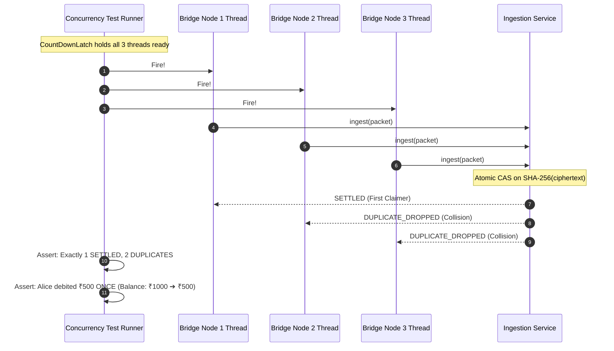

# Testing Strategy & Concurrency Verification — GhostPay

**Testing Framework**: JUnit 5, AssertJ, Spring Boot Test  
**Concurrency Tooling**: `java.util.concurrent.CountDownLatch`, `ExecutorService`  
**Execution Environment**: Local JDK 21 / 23 & Maven Surefire  

---

## 1. Testing Pyramid & Strategy

GhostPay requires rigorous automated verification across three tiers:

```
        / \
       /   \     Tier 3: Multi-Threaded Stress Tests (Duplicate Storm)
      /=====\    [Simulate 3+ bridges uploading simultaneously via CountDownLatch]
     /       \
    /=========\  Tier 2: Spring Boot Integration Tests
   /           \ [JPA Transactions, H2 DDL, Repository Queries, Controller Endpoints]
  /=============\
 /               \ Tier 1: Pure Unit Tests (Fast & Sub-Second)
/_________________\ [Hybrid Crypto Roundtrip, AEAD Tamper Rejection, Account Invariants]
```

---

## 2. Running Tests

### 2.1 From the Terminal (Maven)
Run all tests:
```powershell
.\mvnw.cmd test
```

Run a specific test class:
```powershell
.\mvnw.cmd test -Dtest=HybridCryptoServiceTest
```

Run a specific test method:
```powershell
.\mvnw.cmd test -Dtest=HybridCryptoServiceTest#shouldRejectTamperedCiphertext
```

### 2.2 From VS Code GUI
* Open any test file (e.g. `HybridCryptoServiceTest.java`).
* Click the green **Play (▶)** icon directly next to the class or method definition.
* Open the **Testing view (🧪)** in the VS Code sidebar to review real-time execution times.

---

## 3. Core Test Suites

### Suite 1: Cryptographic Verification (`HybridCryptoServiceTest.java`)
Validates that our hybrid cipher adheres to zero-trust standards:

| Test Name | Verification Goal |
|---|---|
| `shouldEncryptAndDecryptSuccessfully` | Verifies full roundtrip: cleartext ➔ AES-GCM ➔ RSA-OAEP ➔ Decrypt ➔ values match. |
| `shouldRejectTamperedCiphertext` | Flips the last byte of the wire buffer. Asserts `assertThrows(SecurityException.class)` due to AES-GCM AEAD authentication tag failure. |
| `shouldProduceValidSha256` | Verifies SHA-256 fingerprint produces exactly 64 lowercase hexadecimal characters. |

---

### Suite 2: The Duplicate Storm Concurrency Test (`IdempotencyConcurrencyTest.java`)

This is the **headline test of the distributed system**. It models 3 bridge phones simultaneously uploading the exact same mesh payment packet within nanoseconds of each other:



#### Blueprint of the Test Harness:
```java
@Test
@DisplayName("Simultaneous delivery by 3 bridge threads must settle exactly once")
void singlePacketDeliveredByThreeBridgesSettlesExactlyOnce() throws Exception {
    int threadCount = 3;
    ExecutorService executor = Executors.newFixedThreadPool(threadCount);
    CountDownLatch startGun = new CountDownLatch(1);
    CountDownLatch doneSignal = new CountDownLatch(threadCount);

    List<IngestResult> results = Collections.synchronizedList(new ArrayList<>());

    for (int i = 0; i < threadCount; i++) {
        final String bridgeId = "phone-bridge-" + i;
        executor.submit(() -> {
            try {
                startGun.await(); // All threads pause until gun fires
                IngestResult res = bridgeIngestionService.ingest(packet, bridgeId, 1);
                results.add(res);
            } catch (Exception e) {
                // capture
            } finally {
                doneSignal.countDown();
            }
        });
    }

    startGun.countDown(); // FIRE ALL THREADS SIMULTANEOUSLY
    doneSignal.await(5, TimeUnit.SECONDS);

    long settledCount = results.stream().filter(r -> r.status() == TransactionStatus.SETTLED).count();
    long droppedCount = results.stream().filter(r -> r.status() == TransactionStatus.DUPLICATE_DROPPED).count();

    assertEquals(1, settledCount, "Must settle exactly once");
    assertEquals(2, droppedCount, "Other 2 threads must be short-circuited as duplicates");
}
```

---

### Suite 3: Domain Invariant Tests
Validates the business domain without starting Spring Boot:
* `Account.hasSufficientFunds()`
* `Account.debit()` throws `IllegalStateException` on negative balance.
* `Account.credit()` throws `IllegalArgumentException` on zero or negative values.
* `MeshPacket.withDecrementedTtl()` decrements and flags `isExpired()` when `ttl == 0`.

---

## 4. Test Isolation & Flakiness Prevention

1. **Deterministic Setup**: Integration tests use `@DirtiesContext` or reset the database between tests.
2. **Fixed Cryptographic Seeds**: Test fixtures use pre-generated test keys or ephemeral keys initialized in `@BeforeEach`.
3. **No Thread Sleeps**: Concurrency tests never use `Thread.sleep()`; they coordinate via `CountDownLatch` and `CompletableFuture`.
